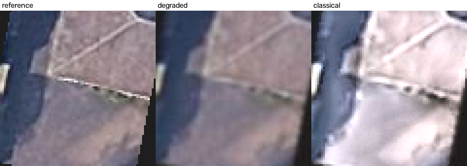
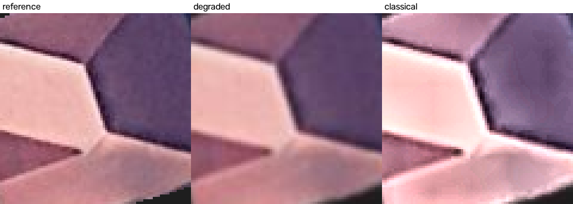
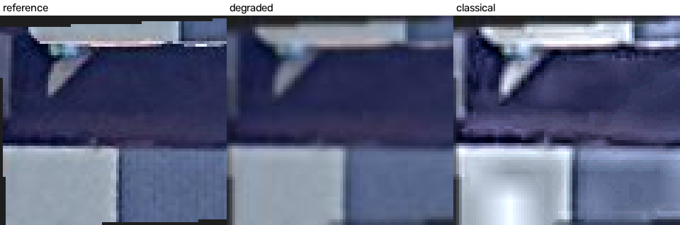

# Satellite Tile Enhancement: Write-up

## 1. Pipeline and reasoning
**Classical:** non-local-means denoise (mild) -> CLAHE contrast on the LAB L channel only -> unsharp mask. Denoise first, so contrast and sharpening do not amplify JPEG blocks and noise; contrast on lightness only, so colours do not shift; sharpen last, so it works on real edges. **SR:** pretrained FSRCNN x2 (OpenCV `dnn_superres`), compared with bicubic. Nothing was trained.

## 2. Evaluation design
There is no ground truth, so each tile is the reference and is degraded on purpose. **A (upscaling):** 2x downscale + noise + JPEG q70, then bicubic vs SR back to full size. **B (classical):** blur + noise + JPEG, then degraded vs classical vs classical without the contrast step. PSNR/SSIM use roof pixels only; real tiles get Laplacian-variance sharpness and colour shift (no reference needed). The supplied data was 24 Google + 17 Mapbox masked building crops, not 20 full tiles; I used the Google crops (see README).
**Results (24 tiles):** SR beats bicubic in 24/24 tiles, but only by ~0.5 dB (25.14 -> 25.62; SSIM 0.676 -> 0.686). Full classical hurts in 24/24 (25.50 -> 21.70 dB); without the contrast step it helps in 24/24 (26.48 dB).
**Weak points:** the tiles are already compressed, so the reference is imperfect; FSRCNN was trained on bicubic-downscaled data, which my degradation resembles (favours SR); my blur favours sharpening; PSNR penalises any tone change, even one that helps a hazy tile; real-tile sharpness rose ~4x, but that includes amplified noise. The Static Maps `scale=2` parameter would give a true 2x reference, but needs an API key I do not have.

## 3. Three failure cases
Each crop shows reference | degraded | classical.
1. **aba1eb (-17 dB):** CLAHE washed out a dull roof; dark navy/brown turned pale grey-pink.

2. **8899da (-13 dB):** bright halos along panel edges and blotchy patches on flat surfaces.

3. **cac04a (-9 dB):** a white glare blob on a light panel, a halo at the top edge, more noise in the dark blue area.

Cause: local contrast exaggerates small differences, and sharpening adds halos.

## 4. 50,000 tiles per day
Denoising is ~95% of the cost (~0.3 s per ~0.15 MP crop on my CPU; roughly 0.8 s for 640x640), so about 11 CPU-hours a day and it falls behind at peaks. I would use a queue with parallel workers, replace non-local means with a bilateral filter, drop CLAHE, and cache by tile hash. Google quota/cost and I/O come next. I would track quality with the no-reference metrics.

## 5. Google Maps Platform Terms of Service
As I read the Terms, Section 3.2.1 restricts copying, modifying and creating derivative works of the Services, and the Service Specific Terms allow caching only for listed content types and for limited periods, so Google imagery is not freely storable. Storing enhanced tiles in our own database and showing them in our product would mean storing Google content and also modifying it, so I expect it to conflict with these terms. We should not do this with Google imagery without written permission from Google. Safer options are to show imagery live through Google's own services, unmodified and with Google's attribution, or to license imagery whose terms allow storage and enhancement. Legal should confirm this against the current Terms and the caching rules for the specific API before we build anything.
